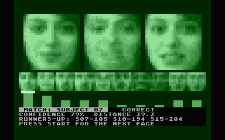
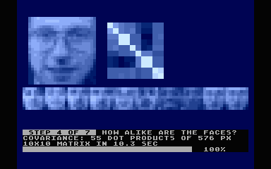
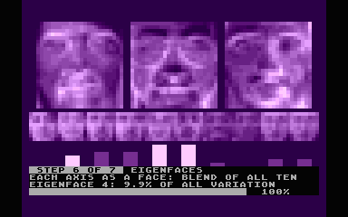

# Eigenfaces on the Atari 8-bit

[](https://github.com/paul-d-carlson/atari-faces/actions/workflows/ci.yml)

Facial recognition with principal component analysis ("eigenfaces"), running
on a 48K Atari 800 with a 1.79 MHz 6502. The demo trains on ten faces from
the Olivetti (AT&T) face database, showing every step of the math as it
happens, then picks out five faces it has never seen.



It follows the method of the article
[Face Recognition using Eigenfaces (Python)](https://hassan-id-mansour.medium.com/face-recognition-using-eigenfaces-python-b857b2599ed0)
by Hassan Id Mansour, which in turn follows Turk & Pentland,
*Eigenfaces for Recognition* (1991). Everything is written in portable C89
for [cc65](https://cc65.github.io/); the only machine code is a 20-byte
display-list interrupt.

New to eigenfaces, eigenvectors or eigenvalues? The comment at the top of
[src/ef_model.h](src/ef_model.h) explains them from scratch, and
[src/ef_model.c](src/ef_model.c) shows how each step is computed in
16-bit integers on the 6502.

## Running it

```
make deps     # once: fetch and build the libatari800 emulator and dir2atr
make atr      # build/faces.atr, a bootable DOS 2.5 disk
make run      # boot it in atari800 (800, 48K, BASIC off)
```

Prebuilt `faces.atr` and `faces.xex` are attached to each
[release](https://github.com/paul-d-carlson/atari-faces/releases), and to
every CI run as the `atari-faces` artifact.

On real hardware, boot `build/faces.atr` with BASIC turned off (hold OPTION
on an XL/XE). START skips a pause; the demo loops over the five mystery
faces forever.

Requirements: cc65 2.18 or later, `make`, a host C/C++ compiler, `curl`
and `tar`. Python with numpy, pillow and scikit-learn is needed only to
regenerate the data (`make data`).

## What the demo shows

| Step | Screen | Math |
|------|--------|-------|
| 1 | Loading the faces | ten 24 x 24 faces, 64 gray levels, from `D:FACES.DAT` |
| 2 | The average face | mean of the training faces |
| 3 | What makes a face unique | each face minus the mean |
| 4 | How alike are the faces? | the 10 x 10 matrix of dot products between centered faces (it stands in for the covariance; see below), entry by entry |
| 5 | Main axes of variation | its top four eigenvectors, by power iteration |
| 6 | Eigenfaces | those axes turned back into images |
| 7 | Every face as four numbers | each face projected onto the eigenfaces |
| - | Mystery faces | project, rebuild from the eigenfaces, rank by distance |

 

The screen is GTIA mode 9 (80 x 40 pixels, 16 shades) above four lines of
40-column text; the display-list interrupt switches between the two.

## How it fits in 48K and 1.79 MHz

- **Small integers.** Pixels are 0..63, so a face minus the mean is a
  signed byte in -63..63. Every product of two of those fits a 16-bit
  `int`, which is what cc65 does quickly.
- **The small matrix.** Instead of the 576 x 576 pixel covariance, the
  model diagonalizes the 10 x 10 matrix of dot products between faces
  (Turk & Pentland's trick); see the comment at the top of
  [src/ef_model.c](src/ef_model.c).
- **One fast inner loop.** Almost all the time goes into dot products of
  signed bytes. [src/ef_kernel.c](src/ef_kernel.c) does them with a
  quarter-square table, `a*b = q(a+b) - q(a-b)` with `q(v) = v*v/4`: two
  table look-ups instead of a multiply.
- **Small steps.** Every slow stage is a function that does one small step
  and returns, so the demo can redraw the screen in between.

Measured on the emulated 6502 (`make test-integration`):

| | Time |
|---|---|
| Training math (mean to weights) | about 53 s |
| Recognizing one face | about 1.3 s |
| RAM free (code + data + 512-byte stack, BASIC off) | about 200 bytes |

## Tests

```
make test              # everything below
make test-host         # unit tests compiled natively, with sanitizers (< 1 s)
make coverage          # the same with an llvm-cov source coverage report
make test-target       # the same unit tests on the emulated 6502
make test-integration  # boot build/faces.atr and check the whole demo
make test-tools        # tests for tools/export_faces.py
```

CI runs all of these on Ubuntu 24.04 for every push and pull request
([.github/workflows/ci.yml](.github/workflows/ci.yml)) and shows the free
memory, timings and coverage in the run summary. Pushing a `v*` tag that
matches `VERSION` in the Makefile publishes the `make dist` archive as a
GitHub release. See [CONTRIBUTING.md](CONTRIBUTING.md) before sending a
change.

The unit tests in [tests/unit](tests/unit) are written once and run both
natively and on the 6502. Natively they run with AddressSanitizer,
UndefinedBehaviorSanitizer and `EF_CHECK_RANGE`, which checks every value
the 6502 keeps in a 16-bit `int` really fits, so an overflow fails on the
host first. The reference suite compares the integer implementation with
a float PCA done by numpy on the same pixels (generated into
[tests/fixtures/ef_reference.h](tests/fixtures/ef_reference.h)): same
mean, same eigenfaces up to sign, same ranking of faces.

On the 6502 the tests run under libatari800, booted from a real DOS 2.5
disk, and report through page six (`$0600`); the runner also prints how
long each phase takes and which source lines ran. The integration test
boots the real demo disk, taps START to skip the pauses, and checks that:
every mystery face is recognized as the reference says; training takes
under 60 s of math and a match under 3 s; the screen never stands still
for more than 1.5 s; no sound-effect click turns into static (noise for
more than 3 frames); and the C stack stays within bounds. It also saves a
screenshot of every screen to `build/integration/screenshots/`.

For performance work, both runners take `--profile FILE`, and
[tools/profile.py](tools/profile.py) turns the result into cycles per
function.

## Data

`data/FACES.DAT` is built by [tools/export_faces.py](tools/export_faces.py)
(`make data`), which also documents the format: ten training faces (two
photos each of five people) and five query faces (a third photo of each).
Photo 71, subject 7, is the query used in the article. The other subjects
were chosen as the set where every query is recognized with the widest
margin using four eigenfaces.

## Layout

```
src/            the demo
  ef_kernel.*   dot products (quarter-square multiply)
  ef_model.*    eigenfaces: training and matching, step by step
  ef_data.*     FACES.DAT parsing
  types.h       integer types for cc65 and the host
  hw.h          Atari addresses (a fake 64K array in the host tests)
  screen.* sound.* sys.* disk.*   Atari display, POKEY, timing, files
  fmt.*         building lines of text without printf
  demo.*        the demo; main.c; atari.cfg (memory map)
tests/unit      unit tests, shared by host and 6502
tests/host      host test main and fake hardware
tests/target    6502 test images
tests/driver    libatari800 test runners
tools/          data exporter, disk builder, profiler, memory report
mk/             make fragments
third_party/    Atari DOS 2.5 (see its README)
```

The math (`ef_*`, `fmt`) has no Atari dependencies; only `screen`,
`sound`, `sys`, `disk` and `demo` would change for another 6502 machine.

## Credits

- Olivetti / AT&T Laboratories Cambridge face database, via scikit-learn's
  `fetch_olivetti_faces`.
- Method: Hassan Id Mansour's article (above); M. Turk and A. Pentland,
  *Eigenfaces for Recognition*, Journal of Cognitive Neuroscience 3(1), 1991.
- Build and test set-up adapted from atari-emacs by the same author.
- `make deps` downloads [atari800](https://github.com/atari800/atari800) and
  [AtariSIO](https://www.horus.com/~hias/atari/) (GPL-2.0) at build time;
  they are not part of this repository. Atari DOS 2.5 is copyright Atari;
  see [third_party/atari-dos25/README.md](third_party/atari-dos25/README.md).

## License

The demo, build system, tools and tests are released under the
[MIT License](LICENSE). The face images in `data/FACES.DAT`, the test
fixture and the screenshots come from the Olivetti / AT&T face database
and remain under its terms. [Atari DOS 2.5](third_party/atari-dos25/README.md)
is © Atari and is included only so the boot disk can be built. See
[NOTICE](NOTICE) for details.
